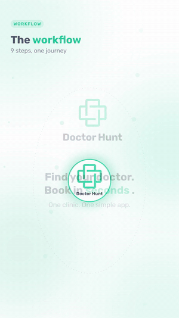

<p align="center">
  
</p>

<p align="center">
  <strong>Find your doctor. Book in seconds.</strong><br/>
  A clinic appointment app for patients and clinic admins, built with Flutter &amp; Firebase.
</p>

<p align="center">
  <a href="https://flutter.dev"></a>
  <a href="https://dart.dev"></a>
  <a href="https://firebase.google.com"></a>
  <a href="https://pub.dev/packages/flutter_bloc"></a>
  <a href="https://github.com/TarekMohammedgg/codeplus-projects/tree/doctor-hunt-bloc"></a>
</p>

<p align="center">
  <a href="https://cdn.jsdelivr.net/gh/TarekMohammedgg/codeplus-projects@f8d1f7d/assets/demo/doctor-hunt-demo.mp4">
    
  </a>
</p>

<p align="center">
  <a href="https://cdn.jsdelivr.net/gh/TarekMohammedgg/codeplus-projects@f8d1f7d/assets/demo/doctor-hunt-demo.mp4"></a>
  &nbsp;
  <a href="https://github.com/TarekMohammedgg/codeplus-projects/tree/doctor-hunt-bloc"></a>
</p>

<p align="center">
  <a href="#-start-here-reviewer-guide">Reviewer guide</a> ·
  <a href="#-demo-video">Demo</a> ·
  <a href="#-workflow-coverage">Workflow coverage</a> ·
  <a href="#-project-structure">Project structure</a> ·
  <a href="#-run-it-locally">Run it</a> ·
  <a href="#-repository-branches">Branches</a>
</p>

---

> [!IMPORTANT]
> **This `main` branch is the index only.** The application source code lives on the
> **[`doctor-hunt-bloc`](https://github.com/TarekMohammedgg/codeplus-projects/tree/doctor-hunt-bloc)** branch.
>
> ```bash
> git clone https://github.com/TarekMohammedgg/codeplus-projects.git
> cd codeplus-projects && git checkout doctor-hunt-bloc
> ```

## 🧭 Start Here (Reviewer Guide)

Follow this path to review the project in about 15 minutes. Every link opens the file on
the `doctor-hunt-bloc` branch.

| # | Look at | Why |
| :---: | :--- | :--- |
| 1 | 🎬 [Demo video](https://cdn.jsdelivr.net/gh/TarekMohammedgg/codeplus-projects@f8d1f7d/assets/demo/doctor-hunt-demo.mp4) (1:30) | See the full patient + admin journey before reading code |
| 2 | 📄 [`workflow.md`](https://github.com/TarekMohammedgg/codeplus-projects/blob/doctor-hunt-bloc/workflow.md) | The locked MVP scope: screens, states and rules the app follows |
| 3 | 🚪 [`lib/main.dart`](https://github.com/TarekMohammedgg/codeplus-projects/blob/doctor-hunt-bloc/lib/main.dart) | App entry: Firebase, dependency injection, router, localization |
| 4 | 🧩 [`core/di/injection.dart`](https://github.com/TarekMohammedgg/codeplus-projects/blob/doctor-hunt-bloc/lib/apps/core/di/injection.dart) | Every service, repository and cubit registered with `get_it` |
| 5 | 🗺️ [`core/router/routes.dart`](https://github.com/TarekMohammedgg/codeplus-projects/blob/doctor-hunt-bloc/lib/apps/core/router/routes.dart) | All screens and type-safe routes (`go_router_builder`) |
| 6 | 📅 [`patient/doctor_booking/`](https://github.com/TarekMohammedgg/codeplus-projects/tree/doctor-hunt-bloc/lib/apps/features/patient/doctor_booking) | One feature end to end: Screen → Cubit → Repository (the booking flow) |
| 7 | 🔒 [`firestore.rules`](https://github.com/TarekMohammedgg/codeplus-projects/blob/doctor-hunt-bloc/firestore.rules) | Who can read / write what: patients own their data, only admin manages doctors |
| 8 | 🧪 [`test/`](https://github.com/TarekMohammedgg/codeplus-projects/tree/doctor-hunt-bloc/test) | 64 test files: models, slot generation, rating, router, cubits, widgets |

**Architecture in one line:**

```text
Screen  →  Cubit  →  Repository  →  Service  →  Firestore / Firebase Auth / Cloudinary
```

**Key rules the code enforces** (from `workflow.md`):

- One app, two roles (**Patient** / **Admin**), one clinic. No doctor login.
- Appointment status is only `upcoming | completed | cancelled`.
- **No double booking:** each slot is locked by a `bookedSlots` document inside a Firestore transaction.
- A review is allowed only for a **completed** appointment, once. The review and the doctor's
  rating average are written in **one transaction**.
- Doctors are **deactivated, never deleted**, so booking history stays intact.
- Every doctor shows the **single clinic location** set by the admin.

---

## 🎬 Demo Video

<p align="center">
  <a href="https://cdn.jsdelivr.net/gh/TarekMohammedgg/codeplus-projects@f8d1f7d/assets/demo/doctor-hunt-demo.mp4"><strong>▶ Watch the full demo (1:30, 3 MB)</strong></a> · <a href="assets/demo/doctor-hunt-demo.mp4">download</a>
</p>

The video opens with the workflow as a mind map, shows each step in the real app, then
comes back to the map and lights that step up.

| Time | Chapter |
| :---: | :--- |
| `00:00` | Intro and the 9-step workflow map |
| `00:04` | Onboarding and choosing a role |
| `00:10` | Sign up and reset password |
| `00:16` | Find a doctor: home, search by specialty, favorites |
| `00:27` | Doctor details: rating and reviews |
| `00:31` | Book a slot: date → time slot → review → confirm |
| `00:44` | Manage booking: upcoming, completed, cancelled |
| `00:49` | Side menu |
| `00:52` | Profile, Arabic / English, logout |
| `01:03` | Admin: login, doctors list, deactivate a doctor |
| `01:14` | Admin: cancel / mark completed, clinic location, settings |
| `01:24` | Every step done |

---

## ✅ Workflow Coverage

Each step of the workflow and where its code lives (`lib/apps/features/...`):

| # | Step | What the user does | Code |
| :---: | :--- | :--- | :--- |
| 1 | Onboarding & role | Splash, onboarding, choose Patient / Admin | `common/onboarding`, `common/role_selection` |
| 2 | Sign up & login | Email / password, Google, reset password | `common/auth` |
| 3 | Find a doctor | Home (Popular, Top Rated), search, specialty filter, favorites | `patient/home`, `patient/find_doctors`, `patient/favorites` |
| 4 | Doctor details | Photo, fee, `4.0 · 3 Reviews`, recent reviews, clinic location | `patient/doctor_details` |
| 5 | Book a slot | Date from working days → free slot → review → confirm | `patient/doctor_booking` |
| 6 | Manage booking | Upcoming (cancel), Completed (rate), Cancelled | `patient/appointments`, `patient/rate_doctor` |
| 7 | Side menu | Quick access to Home, Favorites, Appointments, Settings, Log out | `common/shell` |
| 8 | Profile & settings | Edit profile, notifications, language, logout | `patient/profile` |
| 9 | Admin dashboard | Doctors, availability, activate / deactivate, appointments, clinic location | `admin/*` |

---

## 🗂️ Project Structure

```text
lib/
├── main.dart                     # entry point
└── apps/
    ├── core/                     # shared by every feature
    │   ├── di/                   # get_it registrations (injection.dart)
    │   ├── router/               # go_router + generated typed routes
    │   ├── services/             # Firestore / Auth / Cloudinary wrappers
    │   ├── models/               # Doctor, Appointment, Review, Availability...
    │   ├── utils/                # slot generator, rating, validators, formatters
    │   ├── theme/                # AppColors, text styles
    │   └── widgets/              # reusable UI (buttons, fields, cards...)
    └── features/
        ├── common/               # onboarding, role selection, auth, shell, appointment details
        ├── patient/              # home, find doctors, details, booking, appointments, rating, profile
        └── admin/                # doctors, create doctor, availability, appointments, profile, settings
```

Every feature follows the same layout:

```text
<feature>/
├── data/            models · service · repositories
└── presentation/    controller/cubit · screens · widgets
```

**Tech stack:** Flutter · `flutter_bloc` (Cubit) · `get_it` · `go_router` + `go_router_builder` ·
`slang` (Arabic / English) · Firebase Auth · Cloud Firestore · Cloudinary (images).

---

## 🚀 Run It Locally

```bash
git clone https://github.com/TarekMohammedgg/codeplus-projects.git
cd codeplus-projects
git checkout doctor-hunt-bloc
flutter pub get
```

1. **Firebase:** run `flutterfire configure` for your own Firebase project
   (Email/Password + Google auth, Cloud Firestore), then
   `firebase deploy --only firestore:rules`.
2. **Environment:** copy `.env.example` to `.env` and set `SERVER_CLIENT_ID`,
   `CLOUDINARY_CLOUD_NAME` and `CLOUDINARY_UPLOAD_PRESET` (unsigned preset).
3. **Admin account:** create a user in Firebase Authentication, then set
   `role: "admin"` on its `users/{uid}` document in Firestore.
4. **Generate code, test and run:**

```bash
dart run build_runner build -d
flutter test
flutter run
```

Full setup, architecture and Firestore model:
[`doctor-hunt-bloc` README](https://github.com/TarekMohammedgg/codeplus-projects/tree/doctor-hunt-bloc#readme).

---

## 📱 How to Use the App

<details>
<summary><strong>As a Patient</strong></summary>

1. Open the app, swipe through onboarding (or **Skip**), tap **Get Started**, choose **Patient**.
2. **Sign up**, **log in**, or continue with **Google**. Forgot your password? Tap **Forgot password**.
3. **Find a doctor** on Home (Popular / Top Rated), with the search bar, or by specialty. Tap ❤️ to save a favorite.
4. Open a doctor to see the fee, rating, recent reviews, available slots and clinic location.
5. Tap **Book Now** → pick a **date** → pick a free **time slot** → **review** → **Confirm**.
6. In **Appointments**: cancel an **Upcoming** visit, **Rate Doctor** on a **Completed** one, view **Cancelled** ones.
7. Use the **side menu** (☰, top left) or the tabs to reach Favorites, Appointments and Settings.
8. In **Profile / Settings**: edit your info, change password, toggle notifications, switch **Arabic / English**, log out.

</details>

<details>
<summary><strong>As an Admin</strong></summary>

> There is no admin sign-up. The admin account is created by the clinic owner (see [Run it locally](#-run-it-locally)).

1. Choose **Admin** and log in with email and password.
2. **Doctors list:** total / active counters, search, specialty filter.
3. **Add a doctor:** photo, name (Arabic & English), specialty and fee.
4. **Availability:** open a doctor → set working days, start / end time and slot duration. This is what patients can book.
5. **Activate / Deactivate** a doctor to hide them from patients without losing history.
6. **Appointments:** All / Upcoming / Completed / Cancelled. **Cancel** or **Mark Completed** (unlocks rating).
7. **Profile:** update the **clinic location**; it applies to every doctor immediately.
8. **Settings:** log out.

</details>

---

## 🌿 Repository Branches

| Branch | Status | What's inside |
| :--- | :---: | :--- |
| **[`doctor-hunt-bloc`](https://github.com/TarekMohammedgg/codeplus-projects/tree/doctor-hunt-bloc)** | ✅ **Final** | Doctor Hunt MVP: Cubits, clean layers, booking, reviews, admin, tests. **Review this one.** |
| [`doctor-hunt`](https://github.com/TarekMohammedgg/codeplus-projects/tree/doctor-hunt) | 🗄️ Earlier | First version (UI-first, services called from widgets). Kept for history. |
| [`doctor-hunt-auth-clean-arch`](https://github.com/TarekMohammedgg/codeplus-projects/tree/doctor-hunt-auth-clean-arch) | 🧪 Experiment | Auth module rebuilt with Clean Architecture next to the MVVM version. |
| [`doctor-hunt-auth-test`](https://github.com/TarekMohammedgg/codeplus-projects/tree/doctor-hunt-auth-test) | 🧪 Experiment | Unit, repository, cubit and widget tests for the auth feature. |
| [`dart-lessons`](https://github.com/TarekMohammedgg/codeplus-projects/tree/dart-lessons) | 📚 Done | Dart fundamentals, OOP, collections and async (Lessons 01–04). |

<details>
<summary><strong>📚 Dart lessons</strong></summary>

| Lesson | Script | Topics |
| :---: | :--- | :--- |
| **01** | `lesson-1.dart` | Variables, types, `const` vs `final`, null safety, conditionals, string interpolation |
| **02** | `lesson-2.dart` | Functions, closures, arrow syntax, higher-order functions |
| **03** | `lesson-3.dart` | OOP, `Product` modeling, collection operations |
| **04** | `lesson-4.dart` | Enhanced enums, `Future`, `async` / `await` |

```bash
git checkout dart-lessons
dart run lesson-1.dart
```

</details>

---

## ℹ️ Internship Details

<p>
  
</p>

| | |
| :--- | :--- |
| **Intern** | Tarek Mohammed |
| **Company** | Code Plus Software House |
| **Track** | Mobile Development (Flutter & Dart) |
| **Final project** | Doctor Hunt |

<br clear="left"/>

---

<p align="center">
  <sub>Doctor Hunt · Code Plus Software House · Flutter &amp; Dart Internship</sub>
</p>
