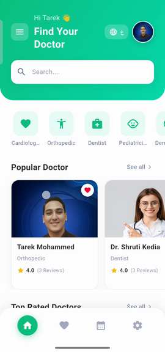
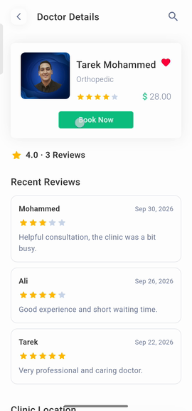
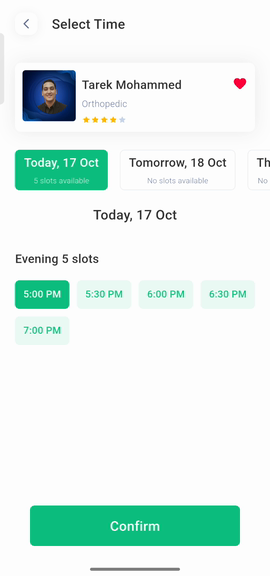
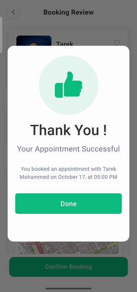
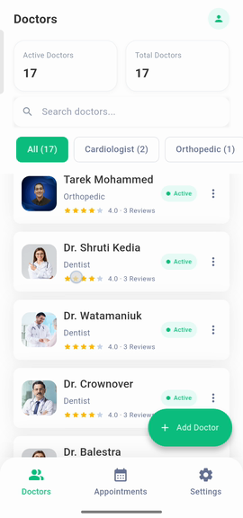
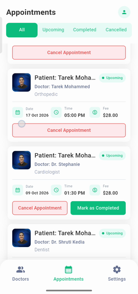

<p align="center">
  
</p>

<p align="center">
  <strong>Find your doctor. Book in seconds.</strong><br/>
  A clinic appointment app for patients and clinic admins, built with Flutter &amp; Firebase.
</p>

<p align="center">
  <a href="https://flutter.dev"></a>
  <a href="https://dart.dev"></a>
  <a href="https://firebase.google.com"></a>
  <a href="https://pub.dev/packages/flutter_bloc"></a>
  
</p>

<p align="center">
  <a href="https://cdn.jsdelivr.net/gh/TarekMohammedgg/codeplus-projects@f8d1f7d/assets/demo/doctor-hunt-demo.mp4">
    
  </a>
</p>

<p align="center">
  <a href="https://cdn.jsdelivr.net/gh/TarekMohammedgg/codeplus-projects@f8d1f7d/assets/demo/doctor-hunt-demo.mp4"></a>
  &nbsp;
  <a href="#-start-here-reviewer-guide"></a>
</p>

<details>
<summary><strong>📑 Table of Contents</strong></summary>

- [About](#-about)
- [Screenshots](#-screenshots)
- [Features](#-features)
- [Start Here (Reviewer Guide)](#-start-here-reviewer-guide)
- [Workflow Coverage](#-workflow-coverage)
- [Project Structure](#-project-structure)
- [Firestore Model](#-firestore-model)
- [Getting Started](#-getting-started)
- [Testing](#-testing)
- [How to Use the App](#-how-to-use-the-app)
- [Main Packages](#-main-packages)
- [Out of Scope (MVP)](#-out-of-scope-mvp)
- [Dart Lessons](#-dart-lessons)
- [Repository Branches](#-repository-branches)
- [Author](#-author)

</details>

---

> [!IMPORTANT]
> **`main` contains the full, final source code of Doctor Hunt** (merged from
> [`doctor-hunt-bloc`](https://github.com/TarekMohammedgg/codeplus-projects/tree/doctor-hunt-bloc)). Clone it and run, no branch switching needed.

## 📖 About

**Doctor Hunt** is a clinic appointment app built during the **Code Plus Software House**
Flutter internship. One app, two roles (**Patient** and **Admin**), one clinic.

Patients find the right doctor, book a free time slot, manage the booking and rate the
doctor after the visit. The clinic admin manages doctors, their working hours,
appointments and the clinic location. The whole app follows one linear journey:

```text
Find Doctor → Doctor Details → Book Slot → Manage Booking → Rate Doctor
```

## 📸 Screenshots

<table>
  <tr>
    <td align="center"><br/><sub><b>Home</b></sub></td>
    <td align="center"><br/><sub><b>Doctor details</b></sub></td>
    <td align="center"><br/><sub><b>Pick a slot</b></sub></td>
  </tr>
  <tr>
    <td align="center"><br/><sub><b>Booking confirmed</b></sub></td>
    <td align="center"><br/><sub><b>Admin: doctors</b></sub></td>
    <td align="center"><br/><sub><b>Admin: appointments</b></sub></td>
  </tr>
</table>

## ✨ Features

### 🧑 Patient
- **Auth** — sign up, login, Google Sign-In, forgot / reset password.
- **Home** — greeting with avatar, search, specialty chips, **Popular** (most reviews)
  and **Top Rated** (highest rating) doctors with *See All*.
- **Doctors** — search by name, filter by specialty, favorites filter. Each card shows
  image, name, specialty, rating + count, fee, heart and *Book Now*.
- **Doctor details** — photo, fee, `4.7 · 24 Reviews` summary, recent reviews,
  available slots and the live clinic location on a map.
- **Booking (4 steps)** — pick a date from the doctor's working days → pick a free slot →
  review → confirm. The slot is locked in a Firestore transaction so two patients
  can never book the same time.
- **Appointments** — Upcoming (cancel), Completed (rate doctor), Cancelled (view only).
- **Rate doctor** — 1–5 stars + optional comment, one review per completed appointment.
  The review and the doctor's rating average are written in one transaction.
- **Profile & settings** — edit photo, name, phone, date of birth, gender; change password,
  notifications toggle, Arabic / English, logout.

### 🛡️ Admin
- **Doctors list** — total / active counters, search and specialty filter.
- **Create / edit doctor** — photo (uploaded to Cloudinary), bilingual name, specialty, fee.
- **Availability** — working days, start / end time, slot duration. This is what
  generates the patient's bookable slots.
- **Activate / deactivate** — doctors are never deleted, so booking history stays intact.
  Patients only see active doctors.
- **Appointments** — tabs Upcoming / Completed / Cancelled; cancel or mark completed.
  Details include the patient's contact info.
- **Profile** — photo, name, and the **clinic location** used by every doctor.

### 🌐 Common
- Onboarding → choose role (Patient / Admin).
- Full **Arabic (RTL)** and **English (LTR)** support with in-app switching (`slang`).

---

## 🧭 Start Here (Reviewer Guide)

Follow this path to review the project in about 15 minutes. Every link opens the file in this repository.

| # | Look at | Why |
| :---: | :--- | :--- |
| 1 | 🎬 [Demo video](https://cdn.jsdelivr.net/gh/TarekMohammedgg/codeplus-projects@f8d1f7d/assets/demo/doctor-hunt-demo.mp4) (1:30) | See the full patient + admin journey before reading code |
| 2 | 📄 [`workflow.md`](workflow.md) | The locked MVP scope: screens, states and rules the app follows |
| 3 | 🚪 [`lib/main.dart`](lib/main.dart) | App entry: Firebase, dependency injection, router, localization |
| 4 | 🧩 [`core/di/injection.dart`](lib/apps/core/di/injection.dart) | Every service, repository and cubit registered with `get_it` |
| 5 | 🗺️ [`core/router/routes.dart`](lib/apps/core/router/routes.dart) | All screens and type-safe routes (`go_router_builder`) |
| 6 | 📅 [`patient/doctor_booking/`](lib/apps/features/patient/doctor_booking) | One feature end to end: Screen → Cubit → Repository (the booking flow) |
| 7 | 🔒 [`firestore.rules`](firestore.rules) | Who can read / write what: patients own their data, only admin manages doctors |
| 8 | 🧪 [`test/`](test) | 64 test files: models, slot generation, rating, router, cubits, widgets |

**Architecture in one line:**

```text
Screen  →  Cubit  →  Repository  →  Service  →  Firestore / Firebase Auth / Cloudinary
```

**Key rules the code enforces** (from `workflow.md`):

- One app, two roles (**Patient** / **Admin**), one clinic. No doctor login.
- Appointment status is only `upcoming | completed | cancelled`.
- **No double booking:** each slot is locked by a `bookedSlots` document inside a Firestore transaction.
- A review is allowed only for a **completed** appointment, once. The review and the doctor's
  rating average are written in **one transaction**.
- Doctors are **deactivated, never deleted**, so booking history stays intact.
- Every doctor shows the **single clinic location** set by the admin.

---

## ✅ Workflow Coverage

Each step of the workflow and where its code lives (`lib/apps/features/...`):

| # | Step | What the user does | Code |
| :---: | :--- | :--- | :--- |
| 1 | Onboarding & role | Splash, onboarding, choose Patient / Admin | `common/onboarding`, `common/role_selection` |
| 2 | Sign up & login | Email / password, Google, reset password | `common/auth` |
| 3 | Find a doctor | Home (Popular, Top Rated), search, specialty filter, favorites | `patient/home`, `patient/find_doctors`, `patient/favorites` |
| 4 | Doctor details | Photo, fee, `4.0 · 3 Reviews`, recent reviews, clinic location | `patient/doctor_details` |
| 5 | Book a slot | Date from working days → free slot → review → confirm | `patient/doctor_booking` |
| 6 | Manage booking | Upcoming (cancel), Completed (rate), Cancelled | `patient/appointments`, `patient/rate_doctor` |
| 7 | Side menu | Quick access to Home, Favorites, Appointments, Settings, Log out | `common/shell` |
| 8 | Profile & settings | Edit profile, notifications, language, logout | `patient/profile` |
| 9 | Admin dashboard | Doctors, availability, activate / deactivate, appointments, clinic location | `admin/*` |

---

## 📂 Project Structure

```text
lib/
├── main.dart                     # entry point
└── apps/
    ├── core/                     # shared by every feature
    │   ├── di/                   # get_it registrations (injection.dart)
    │   ├── router/               # go_router + generated typed routes
    │   ├── services/             # Firestore / Auth / Cloudinary wrappers
    │   ├── models/               # Doctor, Appointment, Review, Availability...
    │   ├── utils/                # slot generator, rating, validators, formatters
    │   ├── theme/                # AppColors, text styles
    │   └── widgets/              # reusable UI (buttons, fields, cards...)
    └── features/
        ├── common/               # onboarding, role selection, auth, shell, appointment details
        ├── patient/              # home, find doctors, details, booking, appointments, rating, profile
        └── admin/                # doctors, create doctor, availability, appointments, profile, settings
```

Every feature follows the same layout:

```text
<feature>/
├── data/            models · service · repositories
└── presentation/    controller/cubit · screens · widgets
```

**Tech stack:** Flutter · `flutter_bloc` (Cubit) · `get_it` · `go_router` + `go_router_builder` ·
`slang` (Arabic / English) · Firebase Auth · Cloud Firestore · Cloudinary (images).

---

## 🔥 Firestore Model

| Collection | Purpose |
| :--- | :--- |
| `users/{uid}` | Profile + `role` (`patient` / `admin`) |
| `users/{uid}/favorites/{doctorId}` | Per-patient favorites |
| `doctors/{id}` | Bilingual name, specialty, fee, image, `isActive`, `rating`, `reviewsCount`, `availability` |
| `clinic/settings` | Clinic address + `GeoPoint` (single source of truth) |
| `appointments/{id}` | Patient + doctor snapshot, `startAt`, `status` (`upcoming` / `completed` / `cancelled`) |
| `bookedSlots/{doctorId_yyyyMMddHHmm}` | Slot lock — prevents double booking |
| `reviews/{appointmentId}` | Rating 1–5 + comment, one per appointment |

Access rules live in [`firestore.rules`](firestore.rules).

---

## 🚀 Getting Started

### Prerequisites

- [Flutter SDK](https://docs.flutter.dev/get-started/install) with Dart `^3.12.2`
- A Firebase project with **Authentication** (Email/Password + Google) and **Cloud Firestore**
- [FlutterFire CLI](https://firebase.google.com/docs/flutter/setup) and [Firebase CLI](https://firebase.google.com/docs/cli)
- A [Cloudinary](https://cloudinary.com) account with an **unsigned** upload preset (doctor photos)

### Install and run

```bash
git clone https://github.com/TarekMohammedgg/codeplus-projects.git
cd codeplus-projects
flutter pub get
```

1. **Firebase:** run `flutterfire configure` for your own Firebase project
   (Email/Password + Google auth, Cloud Firestore), then
   `firebase deploy --only firestore:rules`.
2. **Environment:** copy `.env.example` to `.env` and set `SERVER_CLIENT_ID`,
   `CLOUDINARY_CLOUD_NAME` and `CLOUDINARY_UPLOAD_PRESET` (unsigned preset).
3. **Admin account:** create a user in Firebase Authentication, then set
   `role: "admin"` on its `users/{uid}` document in Firestore.
4. **Generate code and run:**

```bash
dart run build_runner build -d
flutter run
```

**`.env` example** (never put a Cloudinary API secret in the app, only the unsigned preset):

```dotenv
SERVER_CLIENT_ID=your_google_web_client_id
CLOUDINARY_CLOUD_NAME=your_cloudinary_cloud_name
CLOUDINARY_UPLOAD_PRESET=your_unsigned_upload_preset
```

> `lib/firebase_options.dart` and `android/app/google-services.json` are not committed;
> `flutterfire configure` generates them for your Firebase project.

---

## 🧪 Testing

```bash
flutter analyze
flutter test
```

**64 test files** cover the core logic (slot generation, rating aggregate, doctor sorting,
validators, models), the router, cubits for every main feature, and widget tests for
key screens and shared widgets. See [`test/`](test).

---

## 📱 How to Use the App

<details>
<summary><strong>As a Patient</strong></summary>

1. Open the app, swipe through onboarding (or **Skip**), tap **Get Started**, choose **Patient**.
2. **Sign up**, **log in**, or continue with **Google**. Forgot your password? Tap **Forgot password**.
3. **Find a doctor** on Home (Popular / Top Rated), with the search bar, or by specialty. Tap ❤️ to save a favorite.
4. Open a doctor to see the fee, rating, recent reviews, available slots and clinic location.
5. Tap **Book Now** → pick a **date** → pick a free **time slot** → **review** → **Confirm**.
6. In **Appointments**: cancel an **Upcoming** visit, **Rate Doctor** on a **Completed** one, view **Cancelled** ones.
7. Use the **side menu** (☰, top left) or the tabs to reach Favorites, Appointments and Settings.
8. In **Profile / Settings**: edit your info, change password, toggle notifications, switch **Arabic / English**, log out.

</details>

<details>
<summary><strong>As an Admin</strong></summary>

> There is no admin sign-up. The admin account is created by the clinic owner (see [Run it locally](#-getting-started)).

1. Choose **Admin** and log in with email and password.
2. **Doctors list:** total / active counters, search, specialty filter.
3. **Add a doctor:** photo, name (Arabic & English), specialty and fee.
4. **Availability:** open a doctor → set working days, start / end time and slot duration. This is what patients can book.
5. **Activate / Deactivate** a doctor to hide them from patients without losing history.
6. **Appointments:** All / Upcoming / Completed / Cancelled. **Cancel** or **Mark Completed** (unlocks rating).
7. **Profile:** update the **clinic location**; it applies to every doctor immediately.
8. **Settings:** log out.

</details>

---

## 📦 Main Packages

| Purpose | Package |
| :--- | :--- |
| State management | [`flutter_bloc`](https://pub.dev/packages/flutter_bloc) |
| Dependency injection | [`get_it`](https://pub.dev/packages/get_it) |
| Routing | [`go_router`](https://pub.dev/packages/go_router) + [`go_router_builder`](https://pub.dev/packages/go_router_builder) |
| Backend | [`firebase_auth`](https://pub.dev/packages/firebase_auth), [`cloud_firestore`](https://pub.dev/packages/cloud_firestore), [`google_sign_in`](https://pub.dev/packages/google_sign_in) |
| i18n | [`slang`](https://pub.dev/packages/slang) + [`slang_flutter`](https://pub.dev/packages/slang_flutter), [`intl`](https://pub.dev/packages/intl) |
| Images | [`image_picker`](https://pub.dev/packages/image_picker), [`dio`](https://pub.dev/packages/dio) (Cloudinary upload), [`cached_network_image`](https://pub.dev/packages/cached_network_image) |
| Booking UI | [`easy_date_timeline`](https://pub.dev/packages/easy_date_timeline), [`time_slot`](https://pub.dev/packages/time_slot) |
| Map | [`flutter_map`](https://pub.dev/packages/flutter_map) + [`latlong2`](https://pub.dev/packages/latlong2) |
| UI helpers | [`skeletonizer`](https://pub.dev/packages/skeletonizer), [`smooth_page_indicator`](https://pub.dev/packages/smooth_page_indicator), [`flutter_native_splash`](https://pub.dev/packages/flutter_native_splash) |
| Config | [`flutter_dotenv`](https://pub.dev/packages/flutter_dotenv), [`shared_preferences`](https://pub.dev/packages/shared_preferences) |

---

## 🚫 Out of Scope (MVP)

Doctor app / login, per-doctor locations, payments, chat, online consultation,
medical records, admin analytics and admin roles are intentionally **not** part of
this version.

---

## 📚 Dart Lessons

> [!NOTE]
> The Dart lessons are part of this internship too, but they are **not on `main`**.
> They live on their own branch: **[`dart-lessons`](https://github.com/TarekMohammedgg/codeplus-projects/tree/dart-lessons)**.

| Lesson | Script | Topics |
| :---: | :--- | :--- |
| **01** | `lesson-1.dart` | Variables, types, `const` vs `final`, null safety, conditionals, string interpolation |
| **02** | `lesson-2.dart` | Functions, closures, arrow syntax, higher-order functions |
| **03** | `lesson-3.dart` | OOP, `Product` modeling, collection operations |
| **04** | `lesson-4.dart` | Enhanced enums, `Future`, `async` / `await` |

```bash
git checkout dart-lessons
dart run lesson-1.dart
```

---

## 🌿 Repository Branches

| Branch | Status | What's inside |
| :--- | :---: | :--- |
| **`main`** | ✅ **Final** | The complete Doctor Hunt app (this README). **Review this one.** |
| **[`doctor-hunt-bloc`](https://github.com/TarekMohammedgg/codeplus-projects/tree/doctor-hunt-bloc)** | 🛠️ Development | Where Doctor Hunt was built; merged into `main`. |
| [`doctor-hunt`](https://github.com/TarekMohammedgg/codeplus-projects/tree/doctor-hunt) | 🗄️ Earlier | First version (UI-first, services called from widgets). Kept for history. |
| [`doctor-hunt-auth-clean-arch`](https://github.com/TarekMohammedgg/codeplus-projects/tree/doctor-hunt-auth-clean-arch) | 🧪 Experiment | Auth module rebuilt with Clean Architecture next to the MVVM version. |
| [`doctor-hunt-auth-test`](https://github.com/TarekMohammedgg/codeplus-projects/tree/doctor-hunt-auth-test) | 🧪 Experiment | Unit, repository, cubit and widget tests for the auth feature. |
| [`dart-lessons`](https://github.com/TarekMohammedgg/codeplus-projects/tree/dart-lessons) | 📚 Done | Dart fundamentals, OOP, collections and async (Lessons 01–04). |


---

## 👤 Author

<p>
  
</p>

| | |
| :--- | :--- |
| **Developer** | Tarek Mohammed · [@TarekMohammedgg](https://github.com/TarekMohammedgg) |
| **Company** | Code Plus Software House |
| **Track** | Mobile Development (Flutter & Dart) internship |
| **Final project** | Doctor Hunt |

<br clear="left"/>

---

<p align="center">
  <sub>Doctor Hunt · Code Plus Software House · Flutter &amp; Dart Internship</sub>
</p>
